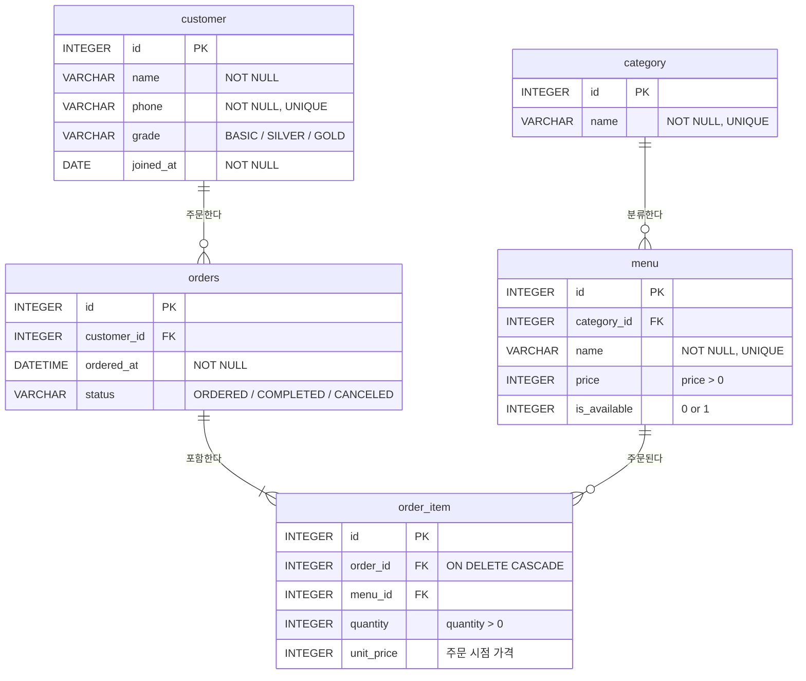

# Task9 · 카페 주문 관리 DB (SQL 실습)

카페의 **고객 · 메뉴 · 주문**을 관리하는 데이터베이스를 설계하고, 요구사항을 SQL로 해결한다.

- **DBMS**: SQLite 3.49 (파일 기반, 별도 서버 불필요)
- **실행 도구**: Python 내장 `sqlite3` 모듈 (`run.py`), DBeaver 등에서 `cafe.db`를 열어 확인 가능
- 백엔드 프레임워크 사용 없음

---

## 1. 제출물 구성

| 파일 / 폴더 | 내용 |
|---|---|
| [schema.sql](schema.sql) | 스키마 생성 (`CREATE TABLE`, PK / FK / NOT NULL / UNIQUE / CHECK) |
| [data.sql](data.sql) | 샘플 데이터 `INSERT` (테이블당 10행 이상) |
| [queries.sql](queries.sql) | 핵심 쿼리 17개 (각 쿼리 위에 한 줄 설명) |
| [results/queries/](results/queries/) | 쿼리별 실행 결과 텍스트 (`Q01.txt` ~ `Q17.txt`, 전체 모음 `_all.txt`) |
| [bonus.sql](bonus.sql) | 보너스 과제 (JOIN vs 서브쿼리, FK 에러 실습, 미니 리포트) |
| [results/bonus/](results/bonus/) | 보너스 실행 결과 텍스트 |
| [run.py](run.py) | SQL 파일을 순서대로 실행하고 결과를 `results/`에 저장하는 스크립트 |
| `cafe.db` | `schema.sql` + `data.sql`만 적용한 SQLite DB 파일 |

## 2. 실행 방법

```bash
python run.py
```

1. `cafe.db`를 새로 만들고 `schema.sql` → `data.sql`을 실행한다.
2. 새 DB에서 `schema.sql` → `data.sql` → `queries.sql`을 실행하고, 결과를 `results/queries/`에 저장한다.
3. 새 DB에서 `schema.sql` → `data.sql` → `bonus.sql`을 실행하고, 결과를 `results/bonus/`에 저장한다.

`sqlite3` CLI를 쓴다면 아래처럼 실행해도 된다.

```bash
sqlite3 cafe.db ".read schema.sql" ".read data.sql" ".read queries.sql"
```

---

## 3. 데이터 모델

### ERD



### 1:N 관계 (4개)

| 부모 (1) | 자식 (N) | FK | 의미 |
|---|---|---|---|
| `category` | `menu` | `menu.category_id → category.id` | 한 카테고리에 여러 메뉴 |
| `customer` | `orders` | `orders.customer_id → customer.id` | 한 고객이 여러 번 주문 |
| `orders` | `order_item` | `order_item.order_id → orders.id` | 한 주문에 여러 메뉴 |
| `menu` | `order_item` | `order_item.menu_id → menu.id` | 한 메뉴가 여러 주문에 등장 |

`orders`와 `menu`는 N:M 관계인데, 이를 `order_item`이라는 중간 테이블과 1:N 관계 두 개로 풀었다.

### 설계 포인트

- **제약조건**: `NOT NULL`(필수 값), `UNIQUE`(`category.name`, `customer.phone`, `menu.name`, `(order_id, menu_id)`), `CHECK`(가격·수량은 양수, 등급·상태는 정해진 값만 허용)
- **FK 동작**: SQLite는 FK 검사가 기본으로 꺼져 있어서 `PRAGMA foreign_keys = ON;`으로 켠다 (SQLite 전용 문법). 없는 값을 참조하면 `FOREIGN KEY constraint failed` 에러가 난다 → [results/bonus/B03.txt](results/bonus/B03.txt)
- **`unit_price`**: 메뉴 가격이 나중에 바뀌어도 과거 주문 금액은 그대로 남도록, 주문 시점의 가격을 따로 저장한다.
- **`ON DELETE CASCADE`**: 주문을 삭제하면 그 주문의 상세 내역도 함께 삭제된다 → [Q17](results/queries/Q17.txt)
- **테이블 이름 `orders`**: `ORDER`는 SQL 예약어(`ORDER BY`)라서 피했다.

### 샘플 데이터

| 테이블 | 행 수 | 비고 |
|---|---:|---|
| category | 10 | |
| customer | 12 | 11·12번은 주문 이력 없음 (LEFT JOIN / 서브쿼리 확인용) |
| menu | 20 | 19번 판매 종료, 20번은 판매 이력 없는 신메뉴 |
| orders | 20 | 2026-08 ~ 2026-10, 완료 16 · 대기 2 · 취소 2 |
| order_item | 38 | |

---

## 4. 핵심 쿼리 목록

결과가 실행 날짜에 따라 달라지지 않도록, 기준일은 **2026-10-12**로 고정했다.

| # | 분류 | 무엇을 확인하는가 | 결과 |
|---|---|---|---|
| Q01 | 기본 조회 | 판매 중인 메뉴 중 가장 비싼 상위 5개 (`WHERE`, `ORDER BY`, `LIMIT`) | [보기](results/queries/Q01.txt) |
| Q02 | 기본 조회 | GOLD 등급 고객을 가입일 순으로 | [보기](results/queries/Q02.txt) |
| Q03 | 기본 조회 | 최근 7일 주문을 최신순으로 | [보기](results/queries/Q03.txt) |
| Q04 | 기본 조회 | '라떼'가 들어간 메뉴 검색 (`LIKE`) | [보기](results/queries/Q04.txt) |
| Q05 | INNER JOIN | 메뉴 + 카테고리 이름 | [보기](results/queries/Q05.txt) |
| Q06 | INNER JOIN | 10월 주문 상세 내역 (4개 테이블 조인) | [보기](results/queries/Q06.txt) |
| Q07 | INNER JOIN | 처리 대기 주문 + 고객 연락처 | [보기](results/queries/Q07.txt) |
| Q08 | LEFT JOIN | 한 번도 주문되지 않은 메뉴 | [보기](results/queries/Q08.txt) |
| Q09 | 집계 | 카테고리별 메뉴 수 · 평균 가격 (`COUNT`, `AVG`) | [보기](results/queries/Q09.txt) |
| Q10 | 집계 | 고객별 주문 횟수 · 총 결제액 랭킹 (`COUNT`, `SUM`) | [보기](results/queries/Q10.txt) |
| Q11 | 집계 | 판매 수량 TOP 5 메뉴 (`SUM`, `HAVING`) | [보기](results/queries/Q11.txt) |
| Q12 | 집계 | 월별 주문 수 · 매출 · 객단가 | [보기](results/queries/Q12.txt) |
| Q13 | 서브쿼리 | 주문 기록이 없는 고객 (`NOT IN`) | [보기](results/queries/Q13.txt) |
| Q14 | 서브쿼리 | 평균 가격보다 비싼 메뉴 (스칼라 서브쿼리) | [보기](results/queries/Q14.txt) |
| Q15 | 인덱스 | `orders(customer_id)`, `orders(ordered_at)` 인덱스 생성 + 실행 계획 확인 | [보기](results/queries/Q15.txt) |
| Q16 | UPDATE | 누적 결제액 30,000원 이상인 고객을 GOLD로 승급 | [보기](results/queries/Q16.txt) |
| Q17 | DELETE | 취소 주문 삭제 + CASCADE로 상세 내역도 삭제되는지 확인 | [보기](results/queries/Q17.txt) |

### 인덱스 적용 이유

`orders.customer_id`는 고객별 주문 조회와 조인에, `orders.ordered_at`은 기간 검색과 정렬에 자주 쓰인다. 인덱스가 없으면 조회할 때마다 테이블 전체를 훑어야(`SCAN`) 한다. 인덱스를 만든 뒤 `EXPLAIN QUERY PLAN`을 실행하면 `SEARCH orders USING INDEX ...`가 나와서, 인덱스로 필요한 행만 바로 찾는다는 것을 확인할 수 있다.

### DB 전용 문법

| 문법 | 사용 위치 | 비고 |
|---|---|---|
| `PRAGMA foreign_keys = ON` | 모든 `.sql` 파일 맨 위 | SQLite 전용 |
| `EXPLAIN QUERY PLAN` | Q15 | SQLite 전용 (MySQL / PostgreSQL은 `EXPLAIN`) |
| `LIMIT` | Q01, Q11 | SQLite / MySQL / PostgreSQL 지원 (표준은 `FETCH FIRST n ROWS ONLY`) |
| `is_available INTEGER` (0/1) | menu | SQLite에는 `BOOLEAN` 타입이 없음 |

---

## 5. 보너스 과제

### 5-1. 같은 요구를 JOIN과 서브쿼리로 풀기

**요구**: 케이크 카테고리 메뉴를 한 번이라도 주문한 고객 → [B01 JOIN](results/bonus/B01.txt) / [B02 서브쿼리](results/bonus/B02.txt)

두 방식 모두 결과는 같다 (이서연, 최지우, 강서윤, 조은우).

| | JOIN | 서브쿼리 (`IN`) |
|---|---|---|
| 동작 | 테이블을 옆으로 이어 붙인 뒤 필터링 | 안쪽 쿼리 결과(id 목록)로 바깥 쿼리를 걸러냄 |
| 중복 | 한 고객이 케이크를 여러 번 주문하면 여러 줄이 나와서 `DISTINCT`가 필요 | `IN`은 포함 여부만 보기 때문에 중복이 생기지 않음 |
| 가져올 수 있는 컬럼 | 조인한 모든 테이블의 컬럼 (예: 주문일, 메뉴명) | 바깥 테이블(`customer`)의 컬럼만 |
| 읽기 쉬움 | 테이블 사이 관계가 한눈에 보임 | "조건을 단계별로 좁혀 간다"는 의도가 잘 드러남 |

→ 고객 정보만 필요하면 서브쿼리(또는 `EXISTS`)가 더 자연스럽고, 주문 정보까지 같이 보여줘야 하면 JOIN이 맞다. 성능은 대부분의 옵티마이저가 비슷한 실행 계획으로 바꿔 주기 때문에, 데이터가 많지 않다면 큰 차이가 없다.

### 5-2. 데이터 정합성 깨뜨려 보기

| 시도 | 결과 | 막히는 이유 | 고치는 방법 |
|---|---|---|---|
| [B03](results/bonus/B03.txt) 없는 고객(999)으로 주문 `INSERT` | `FOREIGN KEY constraint failed` | 부모 행이 없는 자식은 "누구의 주문인지" 알 수 없음 | 부모(고객)를 먼저 만든 뒤 자식을 넣는다 ([B06](results/bonus/B06.txt)) |
| [B04](results/bonus/B04.txt) 주문이 있는 고객 `DELETE` | `FOREIGN KEY constraint failed` | 지우면 남은 주문이 존재하지 않는 고객을 가리키게 됨 (고아 데이터) | 자식(주문)을 먼저 지우거나, FK에 `ON DELETE CASCADE` / `SET NULL`을 설정한다 |
| [B05](results/bonus/B05.txt) 주문 상세 메뉴를 없는 메뉴(999)로 `UPDATE` | `FOREIGN KEY constraint failed` | `UPDATE`도 FK 검사 대상 | 존재하는 `menu.id`로만 변경한다 |

> FK 검사를 끄면(`PRAGMA foreign_keys = OFF`, SQLite의 기본값) 위 세 가지가 모두 통과돼서 데이터가 깨진다. SQLite에서는 연결할 때마다 이 설정을 켜야 한다는 점이 중요하다.

### 5-3. 미니 리포트 · 핵심 지표 3개

| 지표 | 왜 보는가 | 결과 요약 |
|---|---|---|
| [B07](results/bonus/B07.txt) 월별 매출과 전월 대비 증감 | 매출이 성장하는지 판단 | 8월 48,800 → 9월 94,300 (+45,500) → 10월 81,300 (-13,000, 10/12까지 집계) |
| [B08](results/bonus/B08.txt) 카테고리별 매출 비중 | 어떤 카테고리에 집중할지 결정 | 커피가 30.5%로 1위, 케이크 14.9%, 베이커리 12.9% |
| [B09](results/bonus/B09.txt) 재방문율 | 단골 고객이 얼마나 되는지 확인 | 주문 고객 9명 중 5명이 2회 이상 주문 (55.6%) |
